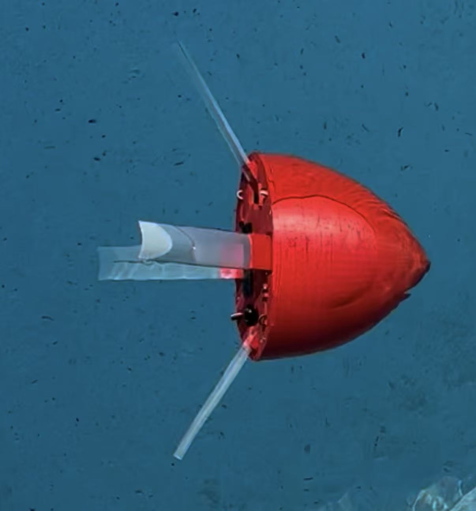
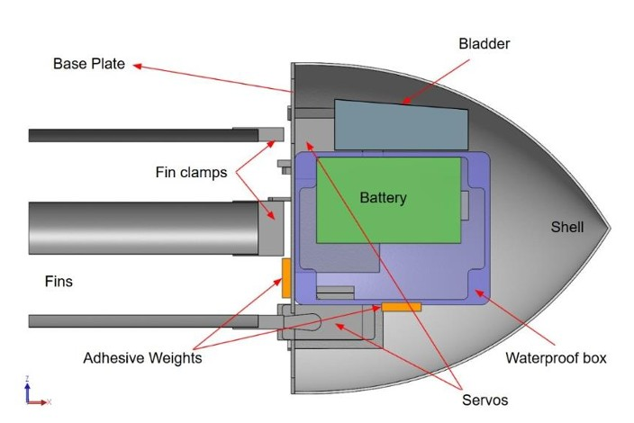

# Biomimetic Robotic Octopus

A biomimetic underwater robot using asymmetrically stiffening flexible fins for propulsion and maneuvering.

<p align="center">
  
</p>

## Overview

This project was developed by a three-person USC engineering team to design, manufacture, and test a compact biomimetic underwater robot. Four servo-actuated flexible fins use asymmetric stiffening to generate propulsion and enable maneuvering.

The prototype completed 3 m swimming trials and demonstrated a 180-degree turn in 5.5 ± 0.4 seconds by deactivating one fin.

## My Contributions

- Independently designed the custom PCB in KiCad and completed system wiring and circuit debugging.
- Led the SolidWorks mechanical design and independently performed the buoyancy calculations.
- Led IMU data acquisition and MATLAB-based data visualization.
- Independently completed waterproofing integration and electrical system validation.
- Co-developed the Arduino-based control software for four servo-actuated fins.
- Led pool testing and analysis of straight-swimming and turning performance.

## System Design

<p align="center">
  
</p>

<p align="center"><em>Cross-sectional SolidWorks model showing the mechanical and electrical system layout.</em></p>

[View the complete SolidWorks source assembly and neutral STEP model.](hardware/mechanical)

### Mechanical Architecture

- Overall vehicle length: 320 mm, including the flexible fins.
- Base plate diameter: 200 mm.
- SolidWorks mass-property and buoyancy models were used to position the center of buoyancy approximately 14 mm above the center of mass for passive restoring stability.
- Four servo-actuated flexible fins generate thrust through asymmetric stiffening and buckling.

### Electrical and Control System

- Arduino Nano RP2040 Connect with an onboard IMU for orientation sensing.
- Four high-torque servo motors actuate the flexible fins.
- Custom PCB designed in KiCad to fit inside the limited waterproof enclosure.
- PCB power traces use a 2 mm width designed to carry at least 4 A.
- Two 7.2 V Ni-MH battery packs divide the electrical load between the Arduino and four servos.
- Electronics are housed inside an IP67-rated junction box with sealed cable penetrations.

## Testing and Results

Pool testing was recorded using multiple GoPro cameras. The robot's position was manually tracked in Physics Tracker and exported for trajectory analysis.

- Completed 3 m straight-swimming trials.
- Measured vertical path deviation ranged from 0.44 m to 0.79 m, demonstrating the need for active stability control.
- Completed a 180-degree turn in 5.5 ± 0.4 seconds across three trials by deactivating one fin.
- IMU acceleration and gyroscope data were evaluated for future pitch, roll, and yaw feedback control.

## Engineering Lessons

- Manufacturer-rated waterproof components should be independently pressure- or immersion-tested before system integration.
- PCB trace width must be determined from the maximum expected current before completing the layout.
- Passive buoyancy and mass distribution improve stability but are not sufficient to reject disturbances during swimming.
- IMU-based closed-loop control could vary individual fin actuation to correct trajectory deviations.

## Tools and Technologies

- **Mechanical:** SolidWorks, 3D printing, buoyancy and mass-property analysis
- **Electrical:** KiCad, custom PCB design, Arduino Nano RP2040 Connect, IMU sensing
- **Software and Analysis:** Arduino C/C++, MATLAB, Microsoft Excel, Physics Tracker
- **Testing:** Pool testing, GoPro video capture, trajectory tracking, electrical validation

## Repository Structure

```text
.
├── hardware/
│   ├── mechanical/
│   │   ├── solidworks/               # SolidWorks assembly and referenced part files
│   │   ├── step/                     # Software-independent STEP assembly
│   │   └── README.md                 # Mechanical design documentation
│   └── pcb/                          # KiCad schematic, PCB layout, and project files
├── software/
│   └── firmware/
│       └── robot_control_ble/        # Arduino BLE servo-control firmware
├── images/                           # Prototype, CAD, and system-design images
├── .gitignore
└── README.md
```

## Future Work

- Implement closed-loop IMU feedback for pitch, roll, and yaw correction.
- Replace the servos with independently validated waterproof actuators.
- Conduct additional trials across multiple fin frequencies and control inputs.
- Improve trajectory tracking and automate experimental data processing.

## Team

Developed as a three-person USC AME 441b senior design project by Frank Zhang, Adrien Ramos, and Kaleigh Ray.

This repository focuses on Frank Zhang's PCB design, electrical integration, mechanical design, buoyancy analysis, sensing, and testing contributions.