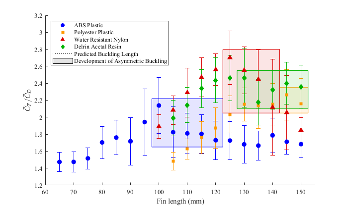

# Tunable-Stiffness Fin Characterization (AME 441a)

The first semester of this senior capstone investigated underwater propulsion using curved, asymmetrically buckling fins. This research preceded the [AME 441b robotic octopus](../../README.md), which focused on integrating the propulsion concept into a swimming robot.

## Experiment

A water-tank test fixture coupled two waterproof servos and 3D-printed mounts to a load cell. Arduino code drove sinusoidal flapping. An NI DAQ recorded load-cell voltage for MATLAB acquisition and analysis. Within each material series, the same fins were tested from longest to shortest, trimming their tips between length conditions.

The final four-material analysis scripts read two trials per length. Each trial is processed separately. For the combined comparison, each script keeps the trial with the smaller `d_ratio`, including its complete coefficient result. These are not averages of the two trials. Third trials were generally acquired after a concern about an earlier recording, according to the author. Replacements were hardcoded when used. The recovered final four-material scripts do not enable third-trial replacements. Earlier DAR analysis does contain an explicit replacement. See [trial-selection provenance](docs/trial-selection.md). Additional recordings remain preserved and indexed; their absence from the final scripts is not evidence that they are invalid.

| Source directory | Material name used in the original work | Lengths | Conditions | Script-referenced trials |
| --- | --- | --- | ---: | ---: |
| `ABS_1127` | ABS Plastic | 65-150 mm, 5 mm increments | 18 | 36 |
| `PP_1122` | Polyester Plastic | 105-150 mm, 5 mm increments | 10 | 20 |
| `N_1122` | Water Resistant Nylon | 100-150 mm, 5 mm increments | 11 | 22 |
| `DAR_1204` | Delrin Acetal Resin | 105-150 mm, 5 mm increments | 10 | 20 |

Directory suffixes are test dates in MMDD format. `PP` follows the project's original naming for Polyester Plastic; it is not expanded here as polypropylene.

## Results

Independent numerical checks of the archived CSV files reproduced all 49 selected thrust-to-drag ratios and their stored `d_ratio` values within an absolute tolerance of 1e-10. Nylon reached a peak ratio of approximately 2.702 at 125 mm. This is a thrust-to-drag ratio, not a measurement of energy efficiency or proof of the largest absolute thrust.



The image is an original export, preserved without regeneration. See [analysis notes](docs/analysis-notes.md) for error-bar definitions, normalization differences and reproduction limits.

## Frank Zhang's Contributions

- Independently designed and modeled the mechanical test fixture.
- Independently performed load-cell calibration.
- Independently developed MATLAB data acquisition, processing and analysis.
- Co-developed and debugged the Arduino servo-control code with a teammate.

Fin fabrication is not presented as Frank's independent or led contribution. The AME 441a team comprised Haylee Mota, Adrien Ramos, Kaleigh Ray and Frank Zhang. The subsequent AME 441b team is documented separately in the main repository.

## Files

```text
firmware/       Recovered dual-servo sinusoidal candidate and earlier sweep variants
original/       Unmodified original MATLAB scripts and four saved result MAT files
figures/        Original comparison and Nylon force-trace exports
data/           Source CSV manifest and small archived calibration summaries
docs/           Processing notes, numerical audit and original-file checksums
```

All 27 `.m` files and four `.mat` result files were copied byte for byte from the recovered source folder. Exploratory and earlier scripts are retained for provenance, not presented as a single runnable pipeline. The downloaded `sinusoidal_input_v2.ino` was subsequently recovered and archived with two earlier sweep variants. See [firmware documentation](firmware/README.md) for provenance and the limits of identifying the exact historical test version.

## Viewing Saved Results in MATLAB

Set MATLAB's Current Folder to this directory, then run:

```matlab
cd original
OverallPlots
```

This loads the four supplied MAT snapshots and plots them without NI hardware or the raw CSV files. Verified with MATLAB R2024a Update 6: the original plotting script generated all three figures. The original processing function was also executed on all 98 referenced trials, with selected ratios and `d_ratio` values matching the saved snapshots within 1e-10. Full coefficient reproduction has the normalization caveat described in the analysis notes. Other scripts contain historical absolute paths. In particular, acquisition and calibration scripts can write files, so inspect and update their paths before executing them.

## Raw Data and Reprocessing

The four final series reference 98 CSV files, totaling about 535 MiB. Those files are present locally and indexed in `data/source_manifest.json`, with relative paths, shapes and SHA-256 hashes. The manifest also indexes additional calibration and experimental CSV files. A complete local `441a-experimental-data.zip` package has been prepared containing all 156 recovered CSV files, including additional tests and calibration data, plus the manifest and trial-selection notes. The bulk raw recordings and ZIP have not been added to Git or uploaded yet.

For those 98 files, the column layout is:

| Column | Quantity | Unit |
| ---: | --- | --- |
| 1 | Time | s |
| 2 | Raw load-cell voltage | V |
| 3 | Filtered voltage | V |
| 4 | Converted force, before analysis baseline subtraction | N |
| 5 | Converted mass equivalent | g |

The CSV files already include processed channels alongside the raw voltage. Do not apply another filter or calibration to column 4 without explicitly defining a new analysis. Historical scripts need path adaptation before CSV reprocessing. Numerical differences documented below must be resolved before claiming full reproduction of every saved force coefficient.
