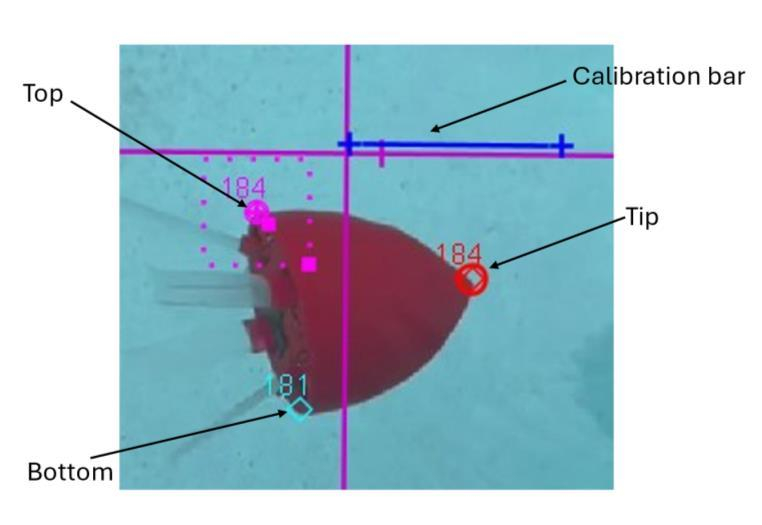
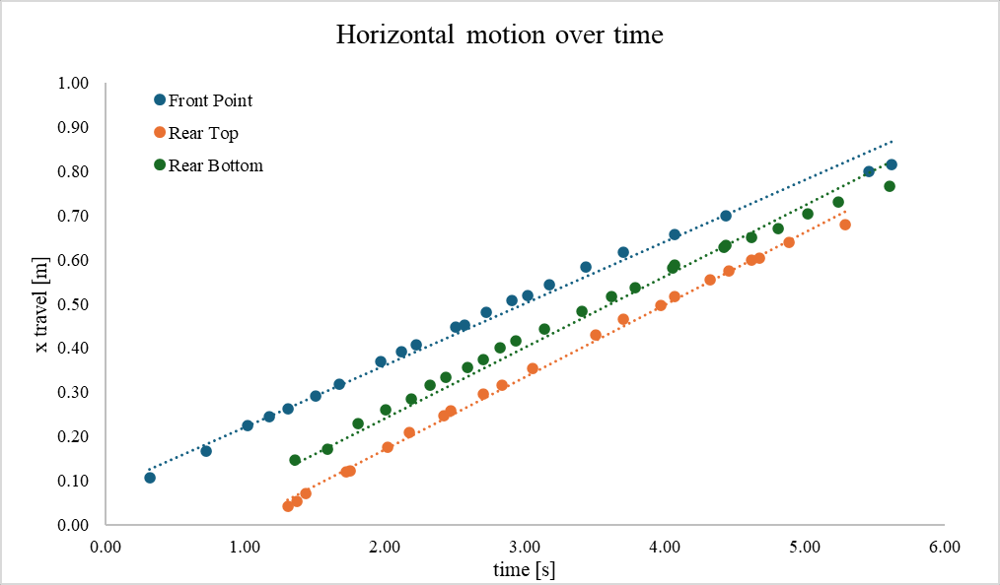
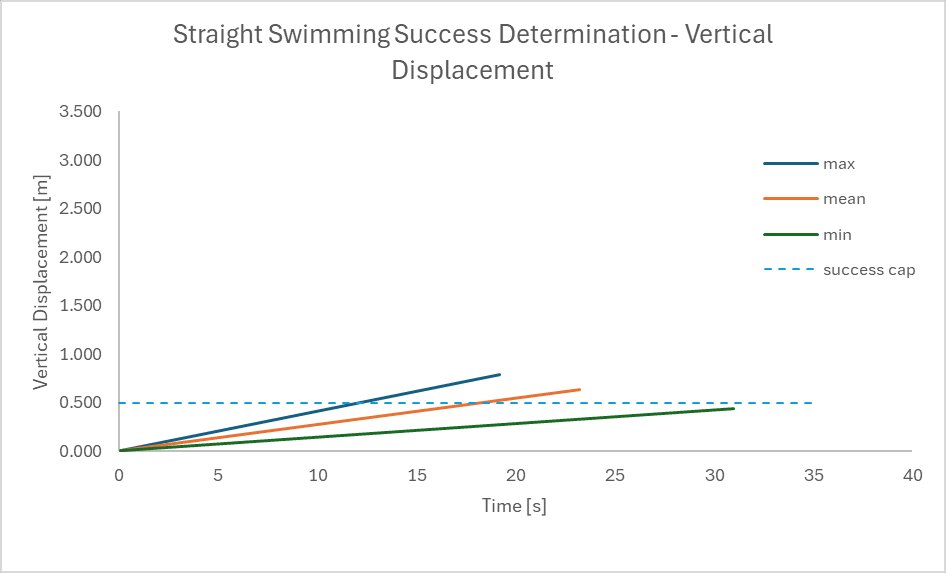
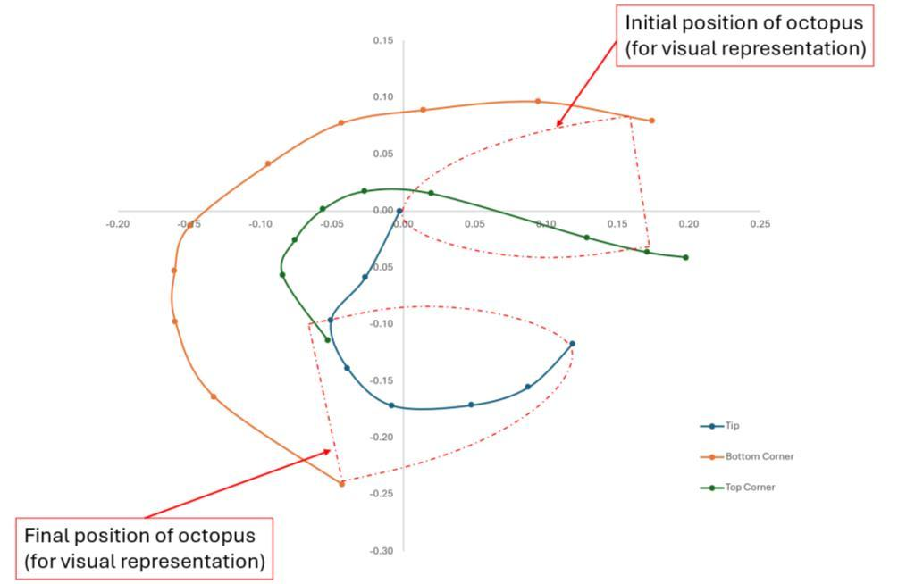

# Pool Swimming and Turning Tests

Pool tests evaluated fin-driven propulsion, passive stability and the turning response of the AME 441b robot. The tests showed the need for active stabilization. This archive preserves recovered Tracker projects and selected figures from the team's Final Report.

## Test Method

The report describes cameras placed on the pool bottom, pool steps and above the water, with overlapping fields of view where possible. The approximately 1.5 m camera field of view limited each recorded segment. The report specifies 1080 resolution, 30 fps and a linear field of view; recovered project timing metadata varies and must be checked against the corresponding videos before reprocessing.

In Physics Tracker, the initial nose-tip position defined the origin and a known robot dimension provided the length calibration. The team marked the nose tip, rear top and rear bottom approximately every 0.5 s, then exported positions to Excel for further analysis. The recovered files retain their original `mass A`, `mass B` and `mass C` track names. Those names are software labels, not three independent trials or measurements of the robot's mass.



## Reported Swimming Results

The design target was 3 m of travel with vertical deviation within +/-0.5 m. Figures 21-22 show recorded motion and fitted trends over the available video segments. The report then extrapolates fitted horizontal and vertical motion to assess a 3 m travel distance in Figure 23.

The reported 0.44-0.79 m vertical-displacement range belongs to that extrapolation. It is not presented here as the measured error of a recovered continuous 3 m trajectory. The report assessed passive stability as partially successful and identified the need for an active control loop.





## Reported Turning Results

Turning tests deactivated one fin and measured the time for a 180-degree reorientation. The report gives 5.5 +/- 0.4 s across three trials. This is a reported aggregate, not a new calculation from the recovered files. The meaning of the +/- term has not been independently established from the original spreadsheet.

The tests characterized an open-loop turning response. Precise commanded-heading control, closed-loop stabilization and trajectory tracking were not implemented. The report states that only the 1:1 recovery-to-power-stroke time ratio was tested; technical problems limited testing to three trials per swimming method.



## Recovered Tracker Files

| Original file | Saved tracks | Saved marking entries | Geometry-based interpretation | Referenced video |
| --- | ---: | ---: | --- | --- |
| [GH017603.trk](original/GH017603.trk) | 3 | 81 | Consistent with straight swimming | `GH017603.mov` |
| [IMG_1200.trk](original/IMG_1200.trk) | 3 | 72 | Consistent with turning | `IMG_1200.mov` |
| [IMG_1201.trk](original/IMG_1201.trk) | 3 | 52 | Consistent with turning | `IMG_1201.mov` |
| [IMG_1202.trk](original/IMG_1202.trk) | 3 | 56 | Consistent with turning | `IMG_1202.MOV` |

The four files contain 261 saved marking entries across 12 tracks. These counts describe recovered file contents, not independent experimental samples. Motion types above are inferred from the geometry of the saved image coordinates. An exact file-to-report-trial mapping remains unconfirmed. In particular, the IMG filenames are not assigned to report turning tests 1, 2 and 3 by filename order.

## Opening and Reproducing the Work

The TRK files are copied byte for byte and require Tracker plus their referenced videos. The four videos and the Excel position-analysis workbook were not recovered with these files. A missing-video prompt is expected until the corresponding video is located. Preserve the original calibration and timing settings when inspecting a working copy, and record any later changes separately.

The included figures are extracted report images. They retain the original labels, fitted curves and annotations. They have not been regenerated from these TRK files, and no new speed, turn-time or stability metric has been calculated for this archive.

See [source notes](docs/source-notes.md) for the report sections, recovery limits and excluded setup-only projects. [The inventory](docs/source-inventory.json) records source hashes and saved metadata.

## Files

```text
original/   Four recovered Tracker projects with saved markings
figures/    Original embedded report images
docs/       Source inventory, verification boundaries and report references
```
